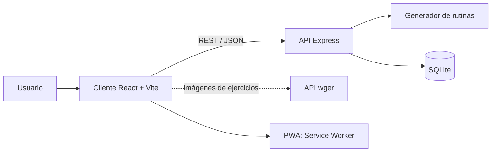

# RutinaFit - Documento de diseño (Sem 2)

## 1. Identidad visual

**Concepto:** una app directa y motivadora que arma tu rutina en segundos. Moderna, oscura por defecto y pensada primero para el celular (mobile-first).

**Tono:** cercano y motivador, con frases cortas. En español se usa voseo.

### Paleta de colores

| Rol | Modo oscuro (por defecto) | Modo claro |
|---|---|---|
| Fondo (`--bg`) | `#0B0F14` | `#F7F9FB` |
| Superficie (`--surface`) | `#151B23` | `#FFFFFF` |
| Borde (`--border`) | `#232C38` | `#E2E8F0` |
| Texto (`--text`) | `#E6EDF3` | `#0F172A` |
| Texto secundario (`--muted`) | `#8B98A9` | `#64748B` |
| Primario (`--primary`) | `#A3E635` | `#4D7C0F` |
| Texto sobre primario (`--on-primary`) | `#0B0F14` | `#FFFFFF` |
| Secundario (`--secondary`) | `#38BDF8` | `#0284C7` |
| Acento (`--accent`) | `#F97316` | `#EA580C` |
| Éxito (`--success`) | `#22C55E` | `#16A34A` |
| Error (`--danger`) | `#EF4444` | `#DC2626` |

Los contrastes se verifican con WebAIM Contrast Checker (RNF4).

### Tipografía
- Títulos: **Poppins** (600 y 700).
- Texto: **Inter** (400 y 500).

### Estilo de componentes
- Bordes redondeados de 12 px en tarjetas y 10 px en botones.
- Sombras suaves, transiciones de 150 a 200 ms.
- Íconos con **Lucide**.
- Botón principal en color primario, con una sola acción principal por pantalla.

## 2. Mapa de pantallas

1. **Inicio:** propuesta de valor y botón "Crear mi rutina".
2. **Formulario:** perfil en 3 pasos (datos, objetivo, disponibilidad).
3. **Rutina generada:** días, ejercicios con gif, regenerar y calentamiento.
4. **Progreso:** gráficos y registro de sesiones.
5. **Historial:** rutinas anteriores.
6. **Rutina compartida:** vista de solo lectura por enlace.
7. **Ajustes:** idioma, tema, recordatorios.

**Navegación:** barra inferior en celular (Inicio, Rutina, Progreso) y barra lateral en escritorio.

## 3. Wireframes (celular)

### Inicio
```
┌──────────────────────────┐
│ [≡]  RutinaFit   [ES] [◐]│
│                          │
│  Tu rutina de gym,       │
│  hecha a tu medida       │
│  Gratis y en segundos.   │
│                          │
│  [  Crear mi rutina  ]   │
│                          │
│  ✓ Según tu objetivo     │
│  ✓ Con gifs de ejercicios│
│  ✓ Seguí tu progreso     │
├──────────────────────────┤
│ Inicio  Rutina  Progreso │
└──────────────────────────┘
```

### Formulario (paso 1 de 3)
```
┌──────────────────────────┐
│ [←]  Crear rutina    1/3 │
│                          │
│  Peso (kg)               │
│  [ 75                 ]  │
│  Altura (cm)             │
│  [ 178                ]  │
│  Edad                    │
│  [ 24                 ]  │
│  Nivel                   │
│  (•) Principiante        │
│  ( ) Intermedio          │
│  ( ) Avanzado            │
│                          │
│  [   Siguiente   →  ]    │
└──────────────────────────┘
```

### Rutina generada
```
┌──────────────────────────┐
│ [←]  Tu rutina    [↗]    │
│  Día 1 · Pecho y tríceps │
│ [Lun] [Mié] [Vie]        │
│                          │
│  ┌──────────────────────┐│
│  │ [gif] Press banca    ││
│  │       4x8-10 · RIR 2 ││
│  │ [↻ Cambiar ejercicio]││
│  └──────────────────────┘│
│  (+ 5 ejercicios más)    │
│                          │
│  [ Ver calentamiento ]   │
├──────────────────────────┤
│ Inicio  Rutina  Progreso │
└──────────────────────────┘
```

### Progreso
```
┌──────────────────────────┐
│ [≡]  Mi progreso         │
│                          │
│  Press banca (kg)        │
│  80 ┤           ╭●       │
│  70 ┤      ╭───╯        │
│  60 ┤  ●──╯              │
│     └──────────────      │
│     S1  S2  S3  S4       │
│                          │
│  Último: 80 kg x 8       │
│  [ + Registrar sesión ]  │
├──────────────────────────┤
│ Inicio  Rutina  Progreso │
└──────────────────────────┘
```

**Escritorio:** barra lateral a la izquierda, contenido centrado con ancho máximo de 960 px y la rutina en dos columnas.

## 4. Arquitectura



### Estructura de carpetas
```
rutinafitia/
├── client/            # React + Vite
│   └── src/
│       ├── components/
│       ├── pages/
│       ├── hooks/
│       ├── i18n/      # es, en, it
│       ├── services/  # llamadas a la API
│       └── styles/
├── server/            # Node + Express
│   └── src/
│       ├── routes/
│       ├── controllers/
│       ├── services/  # generador de rutinas
│       └── db/
├── docs/
└── README.md
```

### Endpoints de la API (v1)

| Método | Ruta | Descripción |
|---|---|---|
| POST | `/api/auth/register` | Crear cuenta |
| POST | `/api/auth/login` | Iniciar sesión |
| GET | `/api/exercises` | Listar ejercicios (filtros por músculo, nivel, equipo) |
| POST | `/api/routines` | Generar rutina a partir del perfil |
| GET | `/api/routines` | Historial del usuario |
| GET | `/api/routines/:id` | Detalle de una rutina |
| POST | `/api/routines/:id/exercises/:reId/regenerate` | Regenerar un ejercicio |
| POST | `/api/routines/:id/share` | Generar enlace para compartir |
| GET | `/api/shared/:token` | Ver rutina compartida |
| GET | `/api/progress?exerciseId=` | Consultar progreso |
| POST | `/api/progress` | Registrar sesión |
| GET / PUT | `/api/reminders` | Consultar y guardar recordatorios |

## 5. Modelo de datos (SQLite)

```sql
CREATE TABLE users (
  id INTEGER PRIMARY KEY AUTOINCREMENT,
  email TEXT UNIQUE NOT NULL,
  password_hash TEXT NOT NULL,
  name TEXT,
  language TEXT DEFAULT 'es',
  created_at TEXT DEFAULT CURRENT_TIMESTAMP
);

CREATE TABLE exercises (
  id INTEGER PRIMARY KEY AUTOINCREMENT,
  name_es TEXT NOT NULL,
  name_en TEXT NOT NULL,
  name_it TEXT NOT NULL,
  muscle_group TEXT NOT NULL,
  equipment TEXT,
  level TEXT CHECK (level IN ('principiante','intermedio','avanzado')),
  type TEXT CHECK (type IN ('compuesto','aislamiento')),
  media_url TEXT
);

CREATE TABLE routines (
  id INTEGER PRIMARY KEY AUTOINCREMENT,
  user_id INTEGER NOT NULL REFERENCES users(id) ON DELETE CASCADE,
  goal TEXT NOT NULL,
  sport TEXT,
  level TEXT NOT NULL,
  days_per_week INTEGER NOT NULL,
  weight_kg REAL,
  height_cm REAL,
  age INTEGER,
  share_token TEXT UNIQUE,
  created_at TEXT DEFAULT CURRENT_TIMESTAMP
);

CREATE TABLE routine_days (
  id INTEGER PRIMARY KEY AUTOINCREMENT,
  routine_id INTEGER NOT NULL REFERENCES routines(id) ON DELETE CASCADE,
  day_number INTEGER NOT NULL,
  title TEXT NOT NULL
);

CREATE TABLE routine_exercises (
  id INTEGER PRIMARY KEY AUTOINCREMENT,
  routine_day_id INTEGER NOT NULL REFERENCES routine_days(id) ON DELETE CASCADE,
  exercise_id INTEGER NOT NULL REFERENCES exercises(id),
  position INTEGER NOT NULL,
  sets INTEGER NOT NULL,
  reps TEXT NOT NULL,
  rir INTEGER,
  rest_seconds INTEGER
);

CREATE TABLE progress_logs (
  id INTEGER PRIMARY KEY AUTOINCREMENT,
  user_id INTEGER NOT NULL REFERENCES users(id) ON DELETE CASCADE,
  exercise_id INTEGER NOT NULL REFERENCES exercises(id),
  weight_kg REAL,
  reps INTEGER,
  logged_at TEXT DEFAULT CURRENT_TIMESTAMP
);

CREATE TABLE reminders (
  id INTEGER PRIMARY KEY AUTOINCREMENT,
  user_id INTEGER NOT NULL REFERENCES users(id) ON DELETE CASCADE,
  day_of_week INTEGER NOT NULL,
  time TEXT NOT NULL,
  enabled INTEGER DEFAULT 1
);
```

**Relaciones:** un usuario tiene muchas rutinas; una rutina tiene muchos días; un día tiene muchos ejercicios; cada ejercicio de la rutina referencia al catálogo `exercises`. El progreso se guarda por usuario y ejercicio.

## 6. Decisiones a confirmar
- **Cuentas de usuario:** se agregan cuando llegue el historial y el progreso (autenticación simple con JWT).
- **Alcance de la "IA":** definir si el generador es un algoritmo de reglas propio o si integra un modelo de lenguaje.
- **Licencia de imágenes:** revisar los términos de wger antes de comercializar.